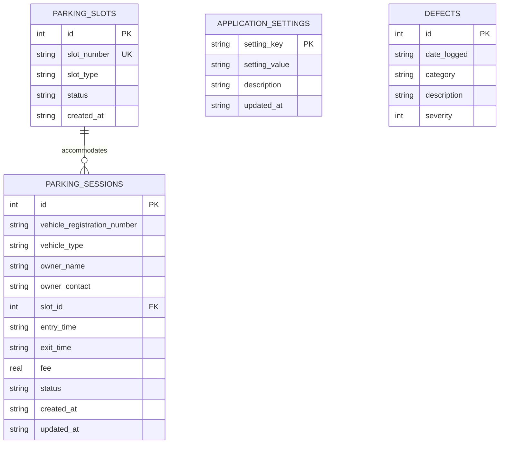

# Parking Management System

[](https://www.python.org/)
[](https://customtkinter.tomschimansky.com/)
[](https://www.sqlite.org/)
[](tests/)
[](docs/USER_MANUAL.md)

An enterprise desktop application engineered for parking facility operations, featuring automated slot allocation, audit-compliant fee calculations, real-time occupancy monitoring, historical session preservation, and Total Quality Management (TQM) defect logging.

---

## Table of Contents
- [1. Project Overview](#1-project-overview)
- [2. Objectives & Features](#2-objectives--features)
- [3. Technology Stack](#3-technology-stack)
- [4. Prerequisites](#4-prerequisites)
- [5. Installation & Execution](#5-installation--execution)
- [6. Folder Structure](#6-folder-structure)
- [7. Database Overview](#7-database-overview)
- [8. Screenshots & User Interface Layout](#8-screenshots--user-interface-layout)
- [9. Testing Instructions](#9-testing-instructions)
- [10. Troubleshooting](#10-troubleshooting)
- [11. Links to Other Documentation](#11-links-to-other-documentation)

---

## 1. Project Overview

The **Parking Management System** is developed as part of the **Total Quality Management (TQM) / Software Quality Engineering** curriculum under quality goal **Q10: Improve Documentation**. It streamlines parking facility logistics by bridging high-level operations with an ACID-compliant database architecture.

### Architectural Principles
- **Strict Separation of Concerns:** Zero SQL queries in presentation code. All user actions route through [`parking_service.py`](parking_service.py) down to [`database.py`](database.py).
- **Zero Race Conditions:** SQLite transactions and partial unique indexes (`WHERE status = 'ACTIVE'`) prevent duplicate active entries and double-booked slots.
- **Auditable Records:** Completed and cancelled sessions remain preserved in history. Billed sessions require administrative override and a recorded audit reason before deletion.

---

## 2. Objectives & Features

### Core Objectives
1. Eliminate manual paper ticketing and automate parking fee computation.
2. Prevent parking conflicts, capacity oversights, and duplicate vehicle admissions.
3. Provide real-time capacity and recorded revenue metrics for facility operators.
4. Maintain financial compliance and audit trails for all vehicle transactions.

### Key Implemented Features
- **📊 Real-Time Dashboard:** Displays total capacity, available slots, occupied slots, currently parked vehicles, completed sessions, and live recorded revenue.
- **🚗 Intelligent Vehicle Entry:** Validates registration plate formats (3–16 characters) and automatically allocates slots based on vehicle classification preferences.
- **🏁 Vehicle Exit & Billing:** Automated duration computation, tiered rate calculation, 15-minute free grace period, operator discount support, and official receipt generation.
- **📋 Parking Records Management:** Parameterized search by keyword (plate/owner/slot), status filtering (`ACTIVE`, `COMPLETED`, `CANCELLED`), vehicle type filtering, permitted record updates, and compliance-guarded safe deletion.
- **🅿️ Interactive Parking Slots Map:** Visual 5-column grid color-coding available (green), occupied (red), and maintenance (gray) bays with one-click exit navigation.
- **❓ In-App Help & FAQ Screen:** Searchable in-app knowledge base covering registration, capacity thresholds, billing policies, and error recovery.
- **ℹ️ Configurable About Page:** Displays academic provenance, version specifications, and configurable placeholders for developer name and student registration number.

---

## 3. Technology Stack

| Layer | Technology | Purpose |
| :--- | :--- | :--- |
| **Language** | Python 3.8+ | Strongly typed, modular application logic |
| **GUI Framework** | CustomTkinter 5.2.2 & Tkinter ttk | Modern, responsive dark/light desktop user interface |
| **Database** | SQLite3 | Persistent embedded relational database with ACID transactions |
| **Service Layer** | Pure Python (`parking_service.py`) | Business logic validation, fee calculation engine, and capacity tracking |
| **Test Automation** | Python `unittest` | Complete unit and integration test coverage across database, service, and GUI |

---

## 4. Prerequisites

Before installing, ensure your environment meets these specifications:
- **Python:** Version 3.8 or higher installed and added to your system `PATH`.
- **Tkinter Support:** Standard Python installations include Tkinter by default. On Debian/Ubuntu Linux systems, install via:
  ```bash
  sudo apt-get install python3-tk
  ```
- **Terminal / Shell:** PowerShell, Command Prompt, or Bash.

---

## 5. Installation & Execution

### 1. Clone or Open the Repository
```bash
cd c:\Users\mukes\Desktop\TQM\Parking-management-system
```

### 2. Set Up a Virtual Environment (Recommended)
```bash
# Windows
python -m venv venv
.\venv\Scripts\activate

# macOS / Linux
python3 -m venv venv
source venv/bin/activate
```

### 3. Install Dependencies
```bash
pip install -r requirements.txt
```

### 4. Launch the Application
```bash
python main.py
```
*Note: On initial startup, the database schema and default 50 slots are automatically generated.*

---

## 6. Folder Structure

```text
Parking-management-system/
├── app/
│   ├── __init__.py               # Application package root
│   ├── database.py               # Package alias and exports for database operations
│   ├── gui.py                    # Complete CustomTkinter GUI views and controller
│   └── parking_service.py        # Package proxy for business logic service layer
├── docs/
│   └── USER_MANUAL.md            # Comprehensive user manual and operational guide
├── tests/
│   ├── __init__.py               # Test package initialization
│   ├── test_database.py          # Unit tests for SQLite schema, constraints, and ACID transactions
│   ├── test_gui.py               # Automated end-to-end GUI workflow and view integration tests
│   └── test_parking_service.py   # Unit tests for business rules, fees, validations, and safe deletions
├── database.py                   # Data Access Layer: SQLite queries, schemas, and connection pools
├── main.py                       # Desktop application launch script and entry point
├── parking_service.py            # Business Logic Layer: validation, fee engine, slot allocation
├── parking_system.db             # SQLite persistent database (created automatically on first run)
├── README.md                     # Interactive project documentation
└── requirements.txt              # Production dependency specifications
```

---

## 7. Database Overview

The persistence layer in [`database.py`](database.py) manages a normalized SQLite database with foreign keys enabled (`PRAGMA foreign_keys = ON;`).



### Tables & Indexes
1. **`parking_slots`**: Tracks the 50 parking slots, categories (`Standard`, `Compact`, `Two-Wheeler`, `EV`), and operational states (`Available`, `Occupied`, `Maintenance`, `Reserved`).
2. **`parking_sessions`**: Records complete vehicle stays with timestamps, assigned slot, owner details, fee, and status (`ACTIVE`, `COMPLETED`, `CANCELLED`).
   - `idx_unique_active_vehicle`: Partial unique index (`WHERE status = 'ACTIVE'`) preventing multiple active sessions for one vehicle.
   - `idx_unique_active_slot`: Partial unique index (`WHERE status = 'ACTIVE'`) preventing a slot from holding multiple active occupants.
3. **`application_settings`**: Stores runtime parameters (hourly rates, grace period, developer identifiers) editable at runtime.
4. **`defects`**: TQM defect reporting table logging quality observations and severities.
5. **`parking_records`**: Backward-compatible SQL view joining sessions with slot metadata.

---

## 8. Screenshots & User Interface Layout

The interface uses a dark/light responsive layout styled with CustomTkinter. Below are the functional layouts for each implemented screen:

### Dashboard Screen Layout
```text
+-----------------------------------------------------------------------------------------------+
| [NAVIGATION SIDEBAR]     | [FACILITY OVERVIEW & DASHBOARD]              [🔄 Refresh Dashboard] |
| ------------------------ | ------------------------------------------------------------------ |
| 📊 Dashboard             | [ TOTAL CAPACITY ]  [ AVAILABLE SLOTS ]  [ OCCUPIED SLOTS ]        |
| 🚗 Vehicle Entry         |       50 Slots              38                    12 (24.0%)          |
| 🏁 Vehicle Exit          |                                                                    |
| 📋 Parking Records       | [ CURRENTLY PARKED ] [ COMPLETED SESSIONS ] [ RECORDED REVENUE ]   |
| 🅿️ Parking Slots         |          12                    84                 $1,640.00           |
| ❓ Help / FAQ            | ------------------------------------------------------------------ |
| ℹ️ About                 | [Utilization Progress Bar: [====================                 ] ] |
|                          | ------------------------------------------------------------------ |
| [Theme: System/Dark]     | Live Active Sessions Table (Session ID, Plate, Type, Slot, Stay)   |
+-----------------------------------------------------------------------------------------------+
```

### Vehicle Entry & Exit Layouts
- **Vehicle Entry:** Left form card (plate input, segmented classification selector, optional owner details, auto vs manual slot selector, register button) and Right confirmation ticket box (permit summary with session ID and assigned slot).
- **Vehicle Exit:** Left search card (plate search, active sessions dropdown, live fee preview, operator discount input, exit button) and Right official receipt card (ASCII receipt summary showing duration, rate, and fee).

### Capturing Custom Screenshots
To embed local image captures of your application instance:
1. Run the application (`python main.py`).
2. Capture screenshot captures of desired tabs (e.g., `Dashboard`, `VehicleEntry`, `VehicleExit`, `ParkingSlots`).
3. Place images in your documentation directory and embed them using standard Markdown image syntax:
   ```markdown
   
   ```

---

## 9. Testing Instructions

The project includes 41 executable unit and integration tests across three suites in [`tests/`](tests/).

### Run Full Test Suite
```bash
python -m unittest discover tests -v
```

### Test Suite Breakdown
1. **[`tests/test_database.py`](tests/test_database.py) (19 tests):**
   - Schema creation, foreign key constraints, default slot seeding.
   - Partial unique indexes preventing duplicate active vehicles and double-booked slots.
   - Idempotent non-destructive database re-initialization.
   - TQM defect logging and severity constraint validation.
2. **[`tests/test_parking_service.py`](tests/test_parking_service.py) (15 tests):**
   - Plate validation (format, length, illegal character rejection).
   - Capacity exhaustion error handling (`ParkingCapacityFullError`).
   - Fee calculation policy (15-min free grace period, 1-hr minimum, ceiling rounding).
   - Dynamic rate configuration via application settings.
   - Safe deletion rules (active session rejection, audit reason requirement for paid sessions).
3. **[`tests/test_gui.py`](tests/test_gui.py) (7 tests):**
   - Screen instantiation and navigation across all 7 views.
   - Real-time KPI synchronization with backend data.
   - End-to-end vehicle entry, search, exit, receipt, and slot release workflows.
   - Search filtering in Help/FAQ and developer personalization in About console.

### Expected Test Output
```text
Ran 41 tests in 25.486s

OK
```

---

## 10. Troubleshooting

| Issue / Error | Likely Cause | Verified Solution |
| :--- | :--- | :--- |
| `ModuleNotFoundError: No module named 'customtkinter'` | Dependency not installed in current environment | Run `pip install -r requirements.txt` within the active environment. |
| `sqlite3.OperationalError: database is locked` | Another process holds an exclusive lock on `parking_system.db` | Close any external SQLite viewer utilities (e.g. DB Browser for SQLite) and restart. |
| `ValidationError: Registration plate length is invalid` | Input has fewer than 3 or more than 16 characters | Enter a valid alphanumeric registration number (e.g., `MH12-AB-1234`). |
| `DuplicateActiveSessionError` | Vehicle is currently recorded as parked inside | Process the vehicle's departure via **Vehicle Exit** before re-registering. |
| `UnsafeDeletionError: Financial audit history must be preserved` | Attempted deletion of a paid completed session without audit reason | In the deletion dialog, enter an official justification (e.g., `Audited test correction`). |

---

## 11. Links to Other Documentation

- 📖 **[User Manual (`docs/USER_MANUAL.md`)](docs/USER_MANUAL.md):** Complete operational guide detailing step-by-step instructions for all screens.
- ⚙️ **[Business Logic Service (`parking_service.py`)](parking_service.py):** Implementation of parking workflow rules, validations, and fee formulas.
- 🗄️ **[Database Access Layer (`database.py`)](database.py):** SQLite schema definitions, queries, and transaction management.
- 🖥️ **[GUI Presentation Module (`app/gui.py`)](app/gui.py):** CustomTkinter view components, layouts, and navigation controller.
- 🚀 **[Application Entry Point (`main.py`)](main.py):** Main application startup script.

---

*Authored for Academic Year 2026 — Total Quality Management (TQM) Quality Goal Q10: Improve Documentation.*
